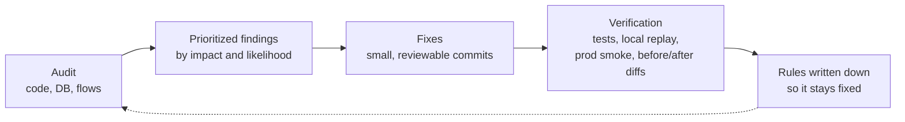
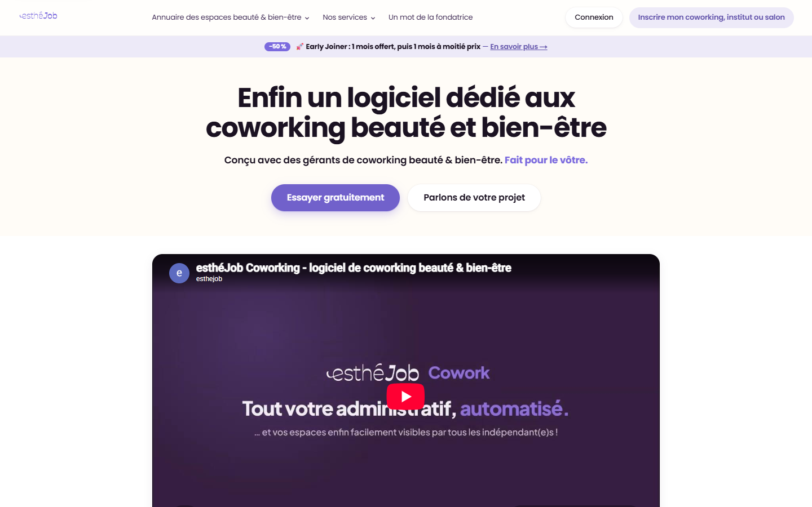
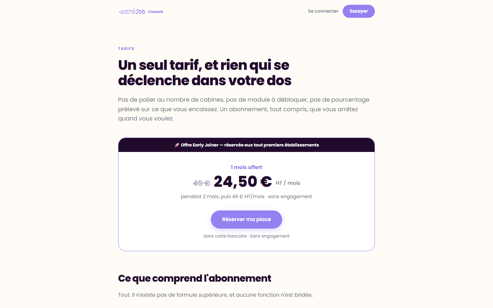
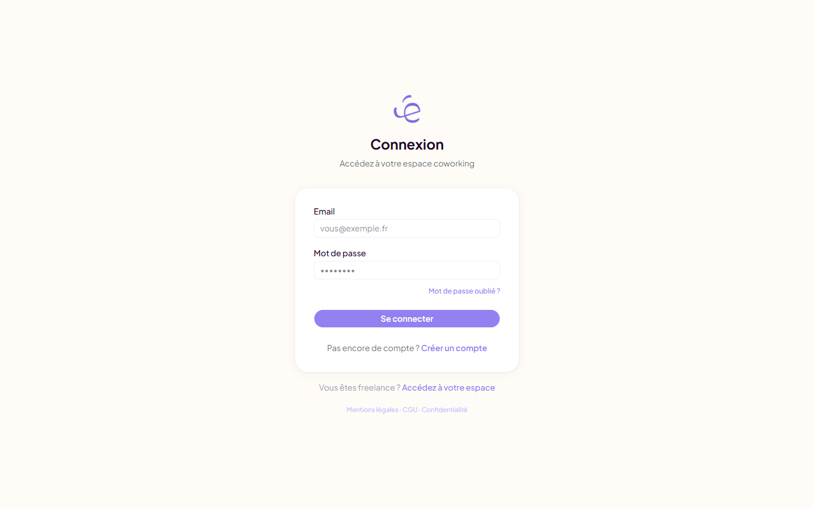
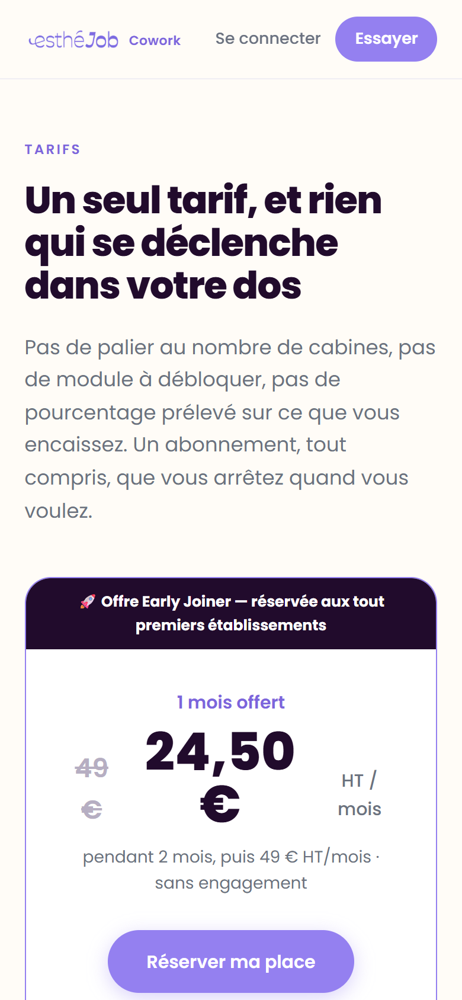
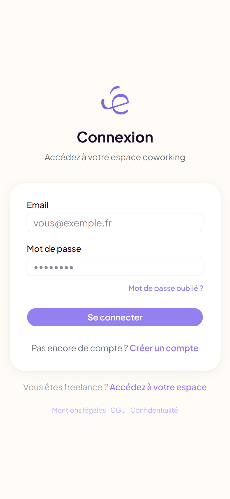

# esthéJob Cowork — security hardening & integration of a production SaaS

Security audit, fixes and platform integration for a live booking and subscription SaaS used by beauty coworking spaces in France.

**Live:** [cowork.esthejob.fr](https://cowork.esthejob.fr) &nbsp;·&nbsp; **Role:** Security & integration lead (September 2026 – present)

> **Source code is private (client project).** This repository is a case study of my contribution. I did **not** build this product: it was designed and built by the client. I joined on 24 September 2026 to audit and harden it and to integrate it with esthéJob, the marketplace I lead. Happy to walk through the work in an interview.

---

## The product (context)

esthéJob Cowork helps owners of beauty coworking spaces run their business: rooms and pricing, recurring and one-off bookings, freelance tenants and their documents, contracts, monthly invoicing, credit notes, reminders and optional online payment through Stripe Connect. Tenants get a portal and a public booking agenda. It handles money, personal documents and access links, which is what makes security work here matter.

## What I did

| Area | Work |
|---|---|
| **Backend security audit** | Reviewed auth flows, database policies and privileges, payment and webhook logic, access links and public forms. Wrote a prioritized report, then fixed the findings. |
| **Database hardening** | Row Level Security review, tighter role privileges, column-level locks on sensitive fields, `SECURITY DEFINER` functions with pinned search paths, storage policies for private documents. |
| **Race conditions** | Promo-code reservations and refunds moved into atomic PostgreSQL functions with row locks, so concurrent checkouts can't oversell a limited code or lose a reserved place. |
| **Auth and account flows** | Hardened sign-up, password reset, email-link confirmation and email change for an account system shared with a second product. |
| **Access links** | Portal and payment links got server-defined lifetimes, single-purpose scope and server-only token writes. |
| **Web security** | Content Security Policy with violation reporting, Cloudflare Turnstile on public forms, removal of `eval` from the client bundle. |
| **Payments** | Idempotent webhook handling, duplicate-charge detection with alerts, per-IP limits on online payments. |
| **Integration** | Moved the app onto esthéJob's database with a single shared login across both products, rehearsed before the production cutover. |
| **Code health & monitoring** | Cleared all 39 React lint errors without changing behaviour; integrated Sentry error tracking with data scrubbing. |

Full write-up of the approach, fix categories and lessons: **[docs/security-hardening.md](docs/security-hardening.md)**.

## Approach

## Screenshots

Public, logged-out pages only.

| Product landing (on esthejob.fr) | Pricing |
|---|---|
|  |  |

| Sign-in (desktop) | Pricing (mobile) | Sign-in (mobile) |
|---|---|---|
|  |  |  |

## Stack

Next.js (App Router) · TypeScript · Supabase (PostgreSQL, Auth, RLS, Storage) · Stripe Connect · Vitest · GitHub Actions · Vercel · Sentry · Cloudflare Turnstile · Claude API (document checks)

## Related

- [esthejob](https://github.com/Robin-Hmaidan/esthejob): the marketplace I lead, including the [shared-database merge case study](https://github.com/Robin-Hmaidan/esthejob/blob/main/docs/case-study-shared-database-merge.md)
- [Profile](https://github.com/Robin-Hmaidan)

---

Robin Hmaidan · robinhmiadan01@gmail.com
